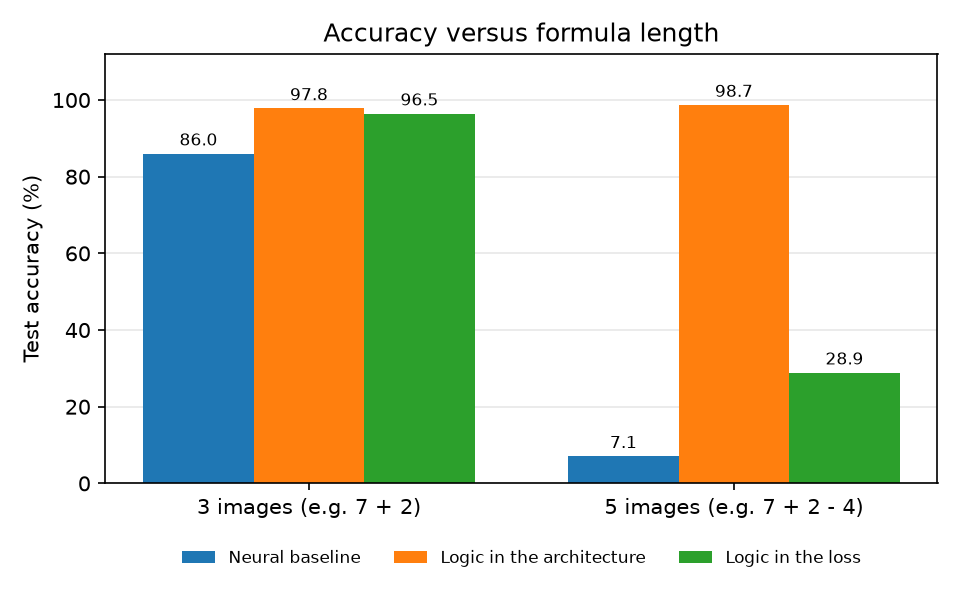

# Neurosymbolic formulas: logic in the architecture versus logic in the loss

Reads a row of handwritten digits and operators (such as `7`, `+`, `2`) and outputs the value of the formula, comparing a plain neural network with two ways of adding the rules of arithmetic: inside the model, or only in the training loss.

## Result

With five images, a plain neural network falls to **7.1%** accuracy; putting the logic in the architecture keeps it at **98.7%**.



| Test accuracy (%) | 3 images (mean ± std, 3 runs) | 5 images (1 run) |
| --- | --- | --- |
| Neural baseline | 86.03 ± 3.30 | 7.10 |
| Logic in the architecture | **97.83 ± 0.65** | **98.70** |
| Logic in the loss | 96.47 ± 0.55 | 28.90 |

30,000 training expressions, 2,000 for validation, 1,000 for testing. Numbers are from the project report (January 2026); the figure is drawn from this table by `scripts/plot_results.py`. Rerunning the 5-image baseline with this repository on the course's data split (seed 0) gave 7.10% again.

Data efficiency (3 images, mean of 3 runs):

| Training expressions | 300 | 3,000 | 30,000 |
| --- | --- | --- | --- |
| Neural baseline | 9.10 | 22.60 | 86.03 |
| Logic in the architecture | **70.60** | **94.17** | **97.83** |
| Logic in the loss | 18.30 | 82.80 | 96.47 |

The only supervision is the final result of each formula. No model ever sees a label for an individual digit or operator.

## How it works

1. **Neural baseline.** A CNN takes all images stacked as channels and classifies the result directly (28 classes for 3 images, 46 for 5). It has to learn every combination of symbols from examples, and with five images there are too many.
2. **Logic in the architecture.** One small CNN recognises digits, another recognises operators. A probabilistic logic program (`result(...) :- digit(...), operator(...), digit(...), add(...)`) combines their outputs. The program is compiled once into AND-OR trees; at run time the trees are evaluated with the networks' probabilities (product for AND, sum for mutually exclusive OR), so the loss on the final answer backpropagates through the reasoning into the symbol classifiers. This is the same idea as [DeepProbLog](https://arxiv.org/abs/1805.10872).
3. **Logic in the loss.** A network with a shared feature extractor predicts the result directly, plus heads for the digits and operators. During training, a logic term penalises predictions that do not form a correct equation, in the spirit of [semantic loss](https://arxiv.org/abs/1711.11157). At inference only the result head is used, so it is a plain neural network.
4. **New task.** Arithmetic modulo 10 with multiplication and division and correct operator precedence (`1 + 2 × 3 = 7`), written as a new logic program (`--task mod10`).

## Quick start

Python 3.10 or newer (tested on 3.14). This runs a smoke test on a small **synthetic** dataset (rendered glyphs, not handwriting); after installation it takes about 2 minutes on a laptop CPU. On this easy data the model reaches about 96% test accuracy; it checks that everything runs, not the results above.

```bash
git clone https://github.com/Magnus-DM/neurosymbolic-formulas.git
cd neurosymbolic-formulas
python -m venv .venv && source .venv/bin/activate
pip install -r requirements.txt

python mathexpression/make_dataset.py --synthetic
python mathexpression/train.py --model architecture --images 3 \
    --train-examples 1000 --val-examples 200 --test-examples 200 --max-steps 1000
```

The script prints a JSON summary with the test accuracy and saves a checkpoint to `mathexpression/checkpoints/`. Use `--model baseline` or `--model loss`, `--images 5`, and `--task mod10` for the other settings.

Full experiments (after downloading the real images, see Data):

```bash
python mathexpression/train.py --model baseline     --images 5
python mathexpression/train.py --model architecture --images 5
python mathexpression/train.py --model loss         --images 5
python mathexpression/evaluate.py --model architecture --images 5   # re-test a saved checkpoint
```

Training runs on the CPU until early stopping. In the report, the 5-image runs took between 7 minutes (baseline) and 2 hours (logic in the architecture).

## Data

The images come from the [Handwritten math symbols dataset](https://www.kaggle.com/datasets/xainano/handwrittenmathsymbols) on Kaggle (45×45 pixel images, one folder per symbol).

1. Download and unpack the archive from Kaggle.
2. Copy the folders `0` to `9`, `+`, `-`, `times` and `div` into `mathexpression/data/hwf/Handwritten_Math_Symbols/`.
3. Build the expression files: `python mathexpression/make_dataset.py`. This writes `math_expression_examples_size_{3,5}.json` (plus and minus) and `..._task_3.json` (modulo-10 task) to `mathexpression/data/hwf/`, with 50,000 / 2,000 / 2,000 expressions for train / validation / test. Every symbol's images are split into disjoint train, validation and test pools.

The expression splits behind the reported numbers were provided by the course and are not redistributed, so a rerun on regenerated splits will not reproduce them exactly. To keep the data elsewhere, set `MATHEXPR_DATA=/path/to/hwf`.

## Project structure

```
mathexpression/
  train.py          train and test one model (all settings as command-line options)
  evaluate.py       re-test a saved checkpoint
  make_dataset.py   build expression files from real or synthetic symbol images
  dataset.py        datasets and logic programs for each model type (course; mod-10 task added)
src/nesy/
  model.py          the three models and their networks (course skeleton, my implementation)
  evaluator.py      batched evaluation of AND-OR trees with neural predicates
  logic.py          forward-chaining logic engine that builds the AND-OR trees (course)
  semantics.py      sum-product semiring (course)
  term.py, parser/  terms, clauses and the logic-program parser (course)
scripts/
  plot_results.py   draws docs/accuracy_vs_length.png from the report's table
```

## Context

Individual project for the course Learning and Reasoning (Leren en Redeneren), Master of Artificial Intelligence, KU Leuven, January 2026.

The course provided a small neurosymbolic framework and the task data. Files from the course carry a header saying so:

- **Provided by the course, unchanged:** the logic engine, semantics, terms and parser (`src/nesy/logic.py`, `semantics.py`, `term.py`, `parser/`), and the class and method signatures in `src/nesy/model.py`.
- **Provided by the course, extended by me:** `mathexpression/dataset.py` (I added the modulo-10 task).
- **My work:** all network architectures and training, validation and test logic in `src/nesy/model.py`; the batched rewrite of `src/nesy/evaluator.py`; the modulo-10 task and its logic programs; the experiments and the report. `train.py`, `evaluate.py`, `make_dataset.py` and `plot_results.py` were added for this public version to make the project runnable from one command.

## References

- R. Manhaeve, S. Dumančić, A. Kimmig, T. Demeester, L. De Raedt. *DeepProbLog: Neural Probabilistic Logic Programming.* NeurIPS 2018. [arXiv:1805.10872](https://arxiv.org/abs/1805.10872)
- J. Xu, Z. Zhang, T. Friedman, Y. Liang, G. Van den Broeck. *A Semantic Loss Function for Deep Learning with Symbolic Knowledge.* ICML 2018. [arXiv:1711.11157](https://arxiv.org/abs/1711.11157)
- Handwritten math symbols dataset, Kaggle. <https://www.kaggle.com/datasets/xainano/handwrittenmathsymbols>

## License

My code is released under the [MIT License](LICENSE). The files marked as provided by the course belong to the course staff of Learning and Reasoning at KU Leuven and are not covered by that license.
